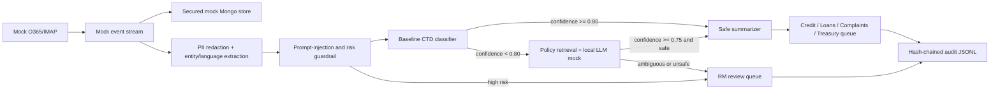

# Meridian Email Analytics Agent POC

A local, deterministic proof of concept for classifying retail-banking emails by Category / Type / Department (CTD), generating a safe receiving-team summary, and routing the case automatically or to a Relationship Manager (RM). It implements the layered design in `Meridian_Email_Analytics_Agent_Architecture.docx` without requiring live O365, Kafka, MongoDB, a vector service, or an external LLM.

## Flow



All model-facing text comes from `PreprocessingResult.model_text`, which contains typed tokens such as `[ACCOUNT_NUMBER]`, `[PAN]`, and `[EMAIL_ADDRESS]`. The compliance agent re-redacts at the RAG boundary, blocks prompt-injection patterns, flags high-risk banking terms, and post-checks generated fields. Raw content is retained only inside the mocked secured document-store boundary.

## Project layout

- `data/mock_emails.json` — 20 synthetic emails, five each for Loans, Credit, Complaints, and Treasury, with synthetic PII.
- `email_analytics_agent/ingestion.py` — mocked mail polling and replayable event stream.
- `email_analytics_agent/storage.py` — Mongo-style document storage and vector policy retrieval.
- `email_analytics_agent/preprocessing.py` — regex PII redaction, masked entity metadata, and language detection.
- `email_analytics_agent/guardrails.py` — inbound/outbound PII, injection, and risk controls.
- `email_analytics_agent/classification.py` — explainable baseline CTD confidence scorer.
- `email_analytics_agent/rag.py` — vector retrieval and inspectable local LLM mock.
- `email_analytics_agent/orchestration.py` — confidence-gated LangGraph manager workflow.
- `email_analytics_agent/routing.py` — redacted summaries and simulated downstream/RM queues.
- `email_analytics_agent/audit.py` — append-only API with a SHA-256 tamper-evident hash chain.
- `tests/` — unit and end-to-end tests covering every required behavior.

## Setup

PowerShell:

```powershell
python -m venv .venv
.\.venv\Scripts\Activate.ps1
python -m pip install -r requirements.txt
```

Python 3.11 or newer is required. The POC uses a deterministic local LLM mock, so no API key or network call is needed at runtime.

## Run the POC

```powershell
.\.venv\Scripts\python.exe -m email_analytics_agent `
  --input data\mock_emails.json `
  --audit logs\audit.jsonl
```

The command prints counts for ingestion, storage, decisions, downstream queues, LLM calls, audit entries, and audit-chain integrity. Each invocation appends to the chosen audit file.

Regenerate the checked-in dataset with:

```powershell
.\.venv\Scripts\python.exe scripts\generate_mock_data.py
```

## Tests

```powershell
.\.venv\Scripts\python.exe -m pytest
```

The suite explicitly verifies:

1. raw PII is removed before the mock LLM receives an email;
2. high-confidence baseline results bypass the LLM and auto-route;
3. low-confidence results invoke policy retrieval and the local LLM;
4. risky, injected, and ambiguous emails enter `rm-review`;
5. every run produces an exact decision path with baseline/RAG confidence scores;
6. the complete 20-email stream reaches storage, downstream queues, and a valid hash-chained audit log.

## Configuration and extension points

`AgentConfig` controls the baseline threshold (`0.80`), RAG threshold (`0.75`), retrieval count, and summary length. Protocol-shaped boundaries make the mock connector, stream, Mongo adapter, vector store, local LLM, queues, and audit sink replaceable with their production equivalents.

For production, replace regex-only PII detection with Presidio/NER, the keyword models with governed trained artifacts, in-memory adapters with durable services, and JSONL with retention-locked/WORM storage. Add attachment malware/OCR processing, authenticated RBAC, encryption/key management, retries/idempotency, telemetry, drift monitoring, RM feedback/retraining, and a shadow-mode rollout before enabling live auto-routing.

