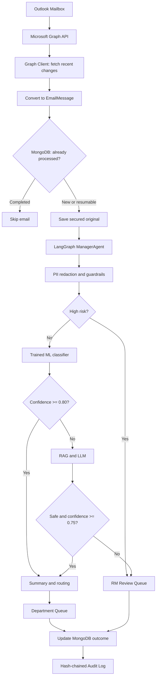

# Meridian Email Analytics Agent POC

A local proof of concept for polling Outlook through Microsoft Graph, classifying retail-banking emails by Category / Type / Department (CTD), generating a safe receiving-team summary, and routing the case automatically or to a Relationship Manager (RM). It implements the new polling design with an offline-testable Graph delta client and a genuinely trained scikit-learn classifier. MongoDB, the vector service, downstream queues, and the fallback LLM remain production-shaped in-memory/local adapters for the POC.

## Flow



All model-facing text comes from `PreprocessingResult.model_text`, which contains typed tokens such as `[ACCOUNT_NUMBER]`, `[PAN]`, and `[EMAIL_ADDRESS]`. Training uses this same production preprocessing path. The compliance agent now makes the high-risk decision before ML, re-redacts at the RAG boundary, blocks prompt-injection patterns, and post-checks generated fields. Raw content is retained only inside the secured document-store boundary.

## Trained model

The primary classifier is a scikit-learn pipeline:

1. word TF-IDF unigrams/bigrams plus character TF-IDF 3–5 grams;
2. class-balanced L2 `LogisticRegression`;
3. regularization selected with five-fold `StratifiedGroupKFold` by semantic template family;
4. sigmoid calibration on a separate group-disjoint calibration partition;
5. `predict_proba()` as the exact LangGraph routing confidence.

The separate corpus contains 692 records: 480 training, 80 calibration, 80 standard validation, 40 hand-authored challenge, and 12 ambiguous/OOD examples. All supervised partitions are balanced across Loans, Credit, Complaints, and Treasury. Every partition has disjoint semantic families and redacted text, and every model input is checked for residual PII.

The headline evaluation combines the untouched standard and challenge sets (120 records):

| Metric | Result |
| --- | ---: |
| Accuracy | 91.67% |
| Macro precision | 91.93% |
| Macro recall | 91.67% |
| Macro-F1 | 91.71% |
| Log loss | 0.266 |
| Multiclass Brier score | 0.123 |
| Expected calibration error | 0.111 |
| Coverage at the selected 0.80 threshold | 75.0% |
| Accuracy among cases above 0.80 | 97.78% |
| Ambiguous/OOD rejection rate | 100% (12/12) |

The ordinary synthetic holdout still scores 100%, while the deliberately difficult cross-intent, negation, typo, and thread-drift challenge set scores 75%. This difference is recorded as an 8.33-point train-to-combined accuracy gap rather than hidden behind the easy split. These figures validate the POC methodology, not production banking performance; a real rollout must retrain and validate against representative RM-labelled historical emails using time-, thread-, and customer-grouped holdouts.

## Project layout

- `data/mock_emails.json` — 20 synthetic emails, five each for Loans, Credit, Complaints, and Treasury, with synthetic PII.
- `data/training_emails.json` — separate 692-record train/calibration/validation/challenge/OOD corpus.
- `artifacts/ctd_classifier.joblib` — trained trusted-local sklearn pipeline.
- `artifacts/ctd_classifier.metrics.json` — dataset hash, environment, evaluation, threshold coverage, and artifact hash.
- `email_analytics_agent/graph_ingestion.py` — Graph delta polling, immutable-ID conversion, paging, throttling, retries, and safe token/transport boundaries.
- `email_analytics_agent/polling.py` — end-to-end polling coordinator and delta-cursor commit boundary.
- `email_analytics_agent/ingestion.py` — legacy fixture connector/event stream retained for compatibility.
- `email_analytics_agent/storage.py` — atomic Mongo-style claims, workflow/audit status, raw storage, and vector policy retrieval.
- `email_analytics_agent/preprocessing.py` — regex PII redaction, masked entity metadata, and language detection.
- `email_analytics_agent/guardrails.py` — inbound/outbound PII, injection, and risk controls.
- `email_analytics_agent/training.py` — leakage checks, model fitting, evaluation, and artifact persistence.
- `email_analytics_agent/classification.py` — hash/version-validated model loading and probability inference.
- `email_analytics_agent/rag.py` — vector retrieval and inspectable local LLM mock.
- `email_analytics_agent/orchestration.py` — confidence-gated LangGraph manager workflow.
- `email_analytics_agent/routing.py` — redacted summaries and simulated downstream/RM queues.
- `email_analytics_agent/audit.py` — append-only API with a SHA-256 tamper-evident hash chain.
- `tests/` — unit and end-to-end tests covering every required behavior.

## Setup

PowerShell:

```powershell
python -m venv .venv
.\.venv\Scripts\Activate.ps1
python -m pip install -r requirements.txt
```

Python 3.11 or newer is required. The checked-in artifact was produced on Python 3.14; the loader deliberately fails closed on a different Python minor or ML-library version, in which case run the training command below in that environment. Offline tests and fixture runs use a deterministic local LLM mock and need no API key or network call. Live Graph polling requires a short-lived Graph access token supplied through the configured token provider.

## Train the model

The checked-in artifact is ready to run in its recorded environment. To reproduce it—or rebuild it for another supported Python environment—run:

```powershell
.\.venv\Scripts\python.exe scripts\generate_training_data.py
.\.venv\Scripts\python.exe scripts\train_model.py
```

Training prints the combined holdout report and writes the model plus metrics sidecar to `artifacts/`. The sidecar separately preserves grouped-CV, training, calibration, standard-validation, challenge, combined-holdout, generalization-gap, threshold and OOD-rejection metrics. Runtime verifies the artifact SHA-256, schema, taxonomy, and exact ML-library versions before loading. Because joblib is pickle-based, only load an artifact produced and reviewed inside the trusted project environment.

## Run the POC

```powershell
.\.venv\Scripts\python.exe -m email_analytics_agent `
  --input data\mock_emails.json `
  --audit logs\audit.jsonl
```

The JSON file represents emails immediately after Graph-to-`EmailMessage` conversion. The command prints counts for ingestion, storage, decisions, downstream queues, LLM calls, audit entries, and audit-chain integrity. Each invocation appends to the chosen audit file.

Regenerate the 20-message integration fixture with:

```powershell
.\.venv\Scripts\python.exe scripts\generate_mock_data.py
```

## Poll Outlook through Microsoft Graph

The complete Graph path is available from the composition root. For a POC shell with an already acquired, short-lived token:

```powershell
$env:MERIDIAN_GRAPH_ACCESS_TOKEN = "<short-lived-token>"
```

```python
from email_analytics_agent import (
    EnvironmentAccessTokenProvider,
    GraphClientConfig,
    build_graph_polling_system,
)

runtime = build_graph_polling_system(
    GraphClientConfig(
        mailbox_id="<mailbox-object-id>",
        tenant_id="<tenant-id>",
        folder_id="inbox",
        initial_received_after="2026-10-01T00:00:00Z",
    ),
    EnvironmentAccessTokenProvider(),
    audit_path="logs/graph-audit.jsonl",
)

poll_result = runtime.coordinator.poll_once()
print(poll_result)
```

The Graph client requests immutable IDs and text bodies, follows every delta page, rejects cross-origin links/redirects, handles `401`, `429` and transient failures, and returns the final delta link without committing it. The coordinator commits that cursor only after every converted email reaches a durable outcome or identifiable malformed record reaches quarantine. For unattended deployment, inject certificate/workload-identity authentication and replace the in-memory Mongo, cursor, queues, vector store, and LLM adapters with durable services.

## Tests

```powershell
.\.venv\Scripts\python.exe -m pytest
```

The suite explicitly verifies:

1. all five partitions are balanced where applicable, PII-safe, unique after redaction, and group-disjoint;
2. the artifact contains word/character TF-IDF, regularized logistic regression, separate calibration and all four fitted classes;
3. returned confidence exactly matches the maximum `predict_proba()` value;
4. fixed-seed training is reproducible and missing/incompatible artifacts fail closed;
5. raw PII is removed before both the trained model and mock LLM receive an email;
6. Graph conversion, immutable-ID headers, delta paging, cursor reuse, throttling, retry and cross-origin token-leak protection;
7. Mongo-style atomic claims, active leases, poison-record quarantine, duplicate skipping, resumable failures, and audit-only recovery;
8. high-confidence ML results bypass the LLM while low-confidence results invoke RAG;
9. risky and injected emails bypass both ML and LLM, while ambiguous emails enter `rm-review`;
10. queue publication and audit append are idempotent and every run records exact confidence scores and decision paths;
11. the complete Graph-to-Mongo-to-LangGraph integration reaches storage, queues, final status, cursor commit, and a valid hash-chained audit log.

## Configuration and extension points

`AgentConfig` controls the calibration-policy ML threshold (`0.80`), RAG threshold (`0.75`), retrieval count, and summary length. `GraphClientConfig` controls mailbox/folder identity, selected fields, page size, timeouts and bounded retries. Protocol-shaped boundaries make authentication, Graph transport, cursor storage, the trained classifier, Mongo adapter, vector store, local LLM, queues, and audit sink replaceable with production equivalents.

For production, replace regex-only PII detection with Presidio/NER, train the classifier on governed RM-labeled data, use a formal model registry, replace in-memory adapters with durable services, and use retention-locked/WORM audit storage. Add attachment malware/OCR processing, authenticated RBAC, encryption/key management, cross-service outbox transactions, telemetry, drift and calibration monitoring, RM feedback/retraining, and a shadow-mode rollout before enabling live auto-routing.

