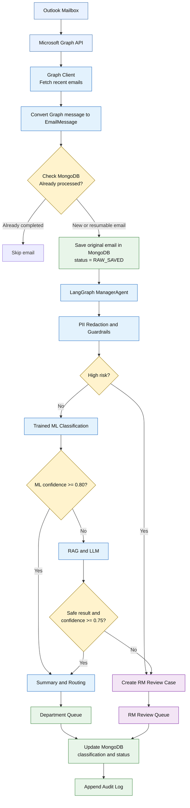
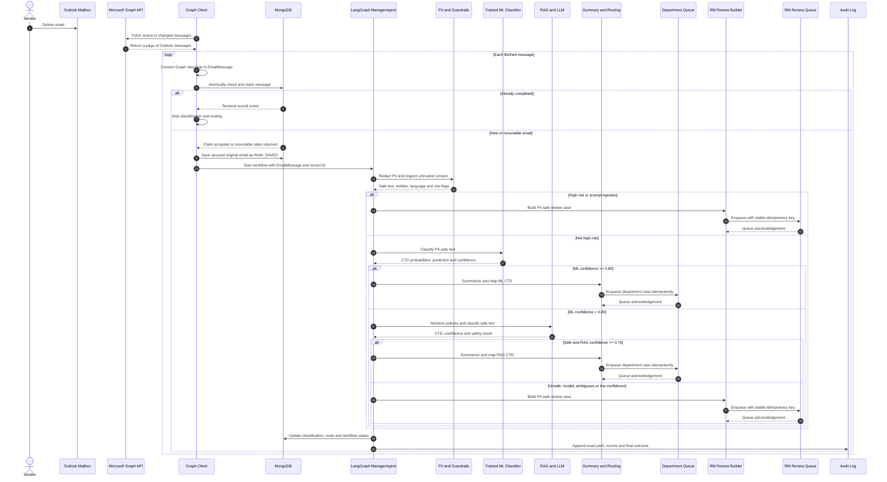
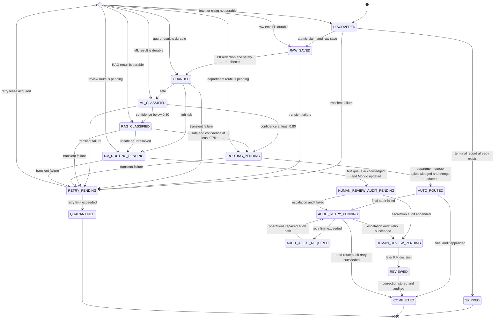

# Outlook and Microsoft Graph Email Analytics Flow

## New authoritative design

This document redesigns the Email Analytics Agent around the user-supplied flow diagram. The diagram is the authoritative logical sequence:

> Outlook Mailbox -> Microsoft Graph API -> Graph Client polling -> `EmailMessage` conversion -> MongoDB duplicate check -> raw-email save -> LangGraph `ManagerAgent` -> PII redaction and guardrails -> risk decision -> trained ML classification -> optional RAG and LLM -> department or RM queue -> final MongoDB update -> audit log.

This design is now implemented in the POC. The repository includes a Microsoft Graph delta client, Graph-to-`EmailMessage` conversion, polling coordinator, atomic Mongo-style workflow state, the pre-ML risk gate, idempotent queues, final outcome persistence and audit-only recovery. MongoDB, cursor storage, queues, the vector service and the fallback LLM remain local/in-memory POC adapters rather than production services.

The new design is polling-based. The Graph Client periodically fetches recent or changed messages. A webhook, Graph subscription, Kafka topic, and change-notification handler are not mandatory parts of this design.

The two confidence boxes in the supplied diagram are interpreted as threshold comparisons:

- `ML confidence >= 0.80`, not confidence exactly equal to `0.80`;
- `RAG result is safe AND confidence >= 0.75`, not confidence exactly equal to `0.75`.

## End-to-end outcome

For every email discovered by the Graph Client, the application produces exactly one of three logical outcomes:

1. **Skip**: MongoDB proves that the message already reached a completed state.
2. **Automatic route**: the email is safe and either the trained ML model or guarded RAG result is sufficiently confident, so a PII-safe case is sent to the predicted department queue.
3. **Human review**: the email is high-risk, unsafe, ambiguous, or insufficiently confident, so a PII-safe case is sent to the RM Review Queue.

The application then records the outcome, classification state, confidence values and exact decision path.

## Complete redesigned flow



## Runtime sequence for a polling cycle



## Component responsibilities

| Component | Responsibility | Must not do |
|---|---|---|
| Outlook Mailbox | Receive and retain operational email in Microsoft 365 | Run classification logic |
| Microsoft Graph API | Provide authorized mailbox access | Act as the application's durable processing state |
| Graph Client | Authenticate, fetch changed messages, follow pages and convert provider data | Send raw messages directly to an LLM |
| `EmailMessage` converter | Produce the provider-independent application model | Decide the CTD |
| MongoDB | Enforce idempotency, hold the secured original and track workflow state | Expose raw PII to general logs |
| LangGraph `ManagerAgent` | Own transitions, decision gates, retries and final outcome | Bypass safety gates |
| PII and Guardrail stage | Redact sensitive values, detect language, screen injection and risk | Persist raw values in model prompts |
| Trained ML classifier | Produce the primary CTD prediction and calibrated confidence | Auto-route a risky email |
| RAG and LLM | Resolve safe, low-confidence ML cases with approved policy context | Receive raw PII or override the allowed taxonomy |
| Summary and Routing | Create a safe case summary and map CTD to a department | Create duplicate tickets on retry |
| RM Review path | Create and enqueue a human-review case | Claim that a human has already completed the review |
| Audit Log | Preserve the exact decision path and evidence | Store raw email bodies or PII |

## 1. One-time environment setup

### 1.1 Microsoft Entra application

Register the backend service in Microsoft Entra ID. Because the Graph Client runs without an interactive employee, it normally uses OAuth 2.0 client credentials with a certificate, managed workload identity or federated credential.

The identity requires permission to read message bodies. `Mail.Read` is therefore needed; `Mail.ReadBasic.All` is not sufficient for this flow. Restrict the service principal to the intended operational mailbox through Exchange Online RBAC for Applications, and verify its effective permission scope.

### 1.2 Polling scheduler

A scheduler starts the Graph Client at a controlled interval. Examples include a Kubernetes CronJob, worker scheduler, Azure Function timer or long-running service with a distributed mailbox lease.

Only one active poller should own a mailbox at a time. MongoDB's unique message key remains the final duplicate defense if two workers overlap.

### 1.3 Required persistent services

Before processing begins, provision:

- MongoDB collections and unique indexes;
- the approved routing-policy vector index used by RAG;
- department queues and the RM Review Queue;
- a tamper-evident or immutable audit destination;
- model-artifact storage and an approved model version;
- secrets, certificates and encryption keys in a managed vault.

## 2. Outlook Mailbox

Exchange Online receives the email and stores it in the monitored Outlook mailbox. At this point, the Email Analytics Agent has not processed it.

Mailbox rules matter. If rules can move new operational messages out of Inbox, the Graph Client must track every relevant folder rather than assuming Inbox contains all work.

## 3. Microsoft Graph API

The Graph Client authenticates as the approved application and reads messages through Microsoft Graph. The access token remains inside the connector; it must never be copied into MongoDB email records, model prompts, exception text or audit events.

The new design does not depend on Graph webhooks. Microsoft Graph is queried by the polling client when the scheduler runs.

## 4. Graph Client: fetch recent emails

“Fetch recent emails” is a logical requirement. In production, the safest implementation is folder-level Graph delta tracking rather than repeatedly scanning a fixed timestamp window.

### Recommended fetch strategy

1. On the first run, request the tracked folder's messages through a delta query.
2. Follow every returned `@odata.nextLink` until the current round is complete.
3. Durably claim or save every returned message in MongoDB.
4. Store the final `@odata.deltaLink` for the next polling cycle.
5. On later runs, call the saved delta link to obtain incremental changes.
6. Advance the saved cursor only after the corresponding message claims are durable.

An identifiable malformed Graph record is stored in the quarantine registry by its tenant/mailbox/message key before cursor commit. A failure without a stable message ID blocks cursor advancement and requires operational correction, preventing silent data loss.

This still implements the diagram's “fetch recent emails” stage, while avoiding a full mailbox scan on every run.

A bounded `receivedDateTime` query with an overlap window can be used for a small POC, but it will intentionally rediscover some messages. MongoDB idempotency must absorb those duplicates. A strict `receivedDateTime > last_poll_time` query without overlap is fragile because a crash or clock/timing boundary can miss mail.

### Fields to retrieve

Request only the fields the workflow needs, for example:

```text
id, internetMessageId, conversationId, subject, from, toRecipients,
ccRecipients, receivedDateTime, body, bodyPreview, hasAttachments,
importance, changeKey
```

Use a plain-text body preference for classification and request Outlook immutable IDs consistently. Preserve `internetMessageId` as supplemental correlation data.

### Paging and throttling

The client must follow `@odata.nextLink`; receiving one page does not mean the polling run is complete. For HTTP `429`, honor `Retry-After`. For transient failures, apply bounded exponential backoff with jitter. Authentication or authorization failures require token/configuration correction rather than infinite retry.

## 5. Convert the Graph message to `EmailMessage`

Graph uses a provider-specific message schema. The converter creates the application's provider-independent domain object before any business decisions are made.

The current POC `EmailMessage` contains:

```text
message_id
sender
subject
body
received_at
metadata
```

Graph-specific values belong in `metadata`, including:

- tenant and mailbox IDs;
- immutable Graph message ID;
- `internetMessageId` and conversation ID;
- recipients and importance;
- Graph `changeKey` or ETag;
- attachment references and scan state;
- source provider and schema version.

A conceptual converted object is:

```json
{
  "message_id": "immutable-graph-message-id",
  "sender": "customer@example.invalid",
  "subject": "Request for loan repayment schedule",
  "body": "Original message body inside the secured boundary",
  "received_at": "UTC timestamp",
  "metadata": {
    "provider": "microsoft-graph",
    "tenant_id": "tenant-guid",
    "mailbox_id": "mailbox-guid",
    "internet_message_id": "RFC-message-id",
    "conversation_id": "graph-conversation-id",
    "source_etag": "graph-etag",
    "attachment_refs": []
  }
}
```

Malformed messages do not silently proceed. Record a retryable conversion failure or quarantine state with a safe error code.

## 6. Check MongoDB: already processed?

This step is both a lookup and an atomic processing claim. A separate “find, then insert” sequence is vulnerable to two workers claiming the same email.

Create a unique index using a key such as:

```text
(tenant_id, mailbox_id, immutable_message_id)
```

Then perform an atomic upsert or claim operation.

### Meaning of the two branches

**Already completed** means the email has a terminal recorded outcome and its downstream action is known. The Graph Client skips classification, RAG and routing. A duplicate-discovery metric or small audit event may be recorded, but no second ticket is created.

**New or resumable email** means one of the following:

- no record exists;
- the email was saved but processing never started;
- a retryable stage failed;
- a previous processing lease expired after a worker crash;
- routing or audit remains pending.

An incomplete record must be reclaimed rather than treated as completed merely because a MongoDB document exists. The POC restarts LangGraph from the secured raw email and relies on idempotent queue and audit operations; a production checkpointer can resume the exact durable node.

## 7. Save the original email in MongoDB

For a new message, store the secured original before LangGraph starts. This provides replay, investigation and recovery if later processing fails.

The initial record should contain:

- the idempotency key;
- the original `EmailMessage` fields;
- provider and mailbox metadata;
- status `RAW_SAVED`;
- a processing lease and attempt count;
- created, received and updated timestamps;
- no model decision yet.

Raw email data is sensitive. Encrypt the collection, restrict it through RBAC, apply retention rules, and exclude raw bodies from normal logs.

Large binary attachments should be encrypted in object storage, with only hashes, scan results and object references stored in MongoDB. Attachment text can join the model input only after malware scanning, safe extraction, PII redaction and injection screening.

LangGraph starts only after the raw save succeeds.

## 8. LangGraph `ManagerAgent`

The manager owns the business workflow after ingestion. Its state carries stable identifiers and safe working data:

- `run_id` and message record ID;
- processing status and decision path;
- redacted text and extracted entity types;
- language and risk flags;
- ML prediction and confidence;
- optional RAG prediction and confidence;
- final summary, destination and queue acknowledgement.

The manager invokes the stages in the order shown in the new design. It must not allow a direct code path from raw email to ML, LLM, summary or queue output that bypasses redaction and guardrails.

## 9. PII redaction and guardrails

The first manager-controlled stage:

1. normalizes subject, body and safe attachment text;
2. detects the language;
3. extracts operational entities;
4. replaces PII with typed tokens;
5. scans the untrusted content for prompt injection;
6. detects banking risk indicators.

Example transformation:

```text
Before: Please review account 991100221234 for customer CUST000123.
After:  Please review account [ACCOUNT_NUMBER] for customer [CUSTOMER_ID].
```

The safe working representation, not the original body, is passed to the trained model, RAG, LLM and summary generator.

Risk checks can include:

- suspected fraud or unauthorized activity;
- prompt-injection or system-override language;
- sanctions or financial-crime indicators;
- legal, regulatory or vulnerable-customer concerns;
- unsupported content or unsafe attachments.

## 10. High-risk decision

This decision occurs **before ML Classification** in the new design.

| Result | Next action |
|---|---|
| High risk = Yes | Bypass both ML and LLM; create an RM review case |
| High risk = No | Run the trained ML classifier |

Routing a high-risk email to RM review is a policy decision, not a model failure. The reason codes are stored without exposing the sensitive values that triggered them.

## 11. Trained ML classification

For a safe email, the genuine trained CTD classifier remains the primary decision engine.

The current POC model uses:

- word TF-IDF unigrams and bigrams;
- character TF-IDF 3-5 grams;
- class-balanced L2 logistic regression;
- separate probability calibration;
- a persisted, versioned scikit-learn artifact.

It receives the PII-safe subject and body and returns:

- Category;
- Type;
- Department;
- calibrated confidence;
- class probabilities;
- model version and provenance.

The current POC supports Credit, Loans, Complaints and Treasury. The production taxonomy may extend to KYC/Compliance and other approved teams.

## 12. ML confidence decision

Apply the threshold to the top predicted probability:

| Condition | Action |
|---|---|
| Safe and ML confidence `>= 0.80` | Do not call the LLM; proceed to Summary and Routing |
| Safe and ML confidence `< 0.80` | Invoke RAG and LLM |

The threshold is a governed operating value. It should be revisited using representative reviewed emails, per-class routing precision, calibration and the acceptable human-review load.

## 13. RAG and LLM fallback

RAG is a fallback, not the default classifier.

For a low-confidence ML result:

1. query the vector store using only the redacted email;
2. retrieve approved, versioned routing-policy chunks;
3. run the pre-LLM PII and injection guardrail again;
4. give the LLM the safe email, allowed CTD taxonomy and retrieved policies;
5. require a structured CTD, confidence and concise rationale;
6. validate the response schema and taxonomy;
7. run post-LLM PII, safety and output checks.

The RAG result includes its own confidence. The earlier ML confidence remains in the workflow state and audit trail.

## 14. RAG safety and confidence decision

The positive branch requires both conditions:

```text
safe_output is true AND rag_confidence >= 0.75
```

| Condition | Action |
|---|---|
| Safe, valid and confidence `>= 0.75` | Proceed to Summary and Routing |
| Unsafe output | RM Review |
| Invalid CTD or response schema | RM Review |
| Ambiguous result | RM Review |
| Confidence `< 0.75` | RM Review |
| LLM unavailable after bounded retries | RM Review or retry according to policy; never guess |

## 15. Summary and Routing

This stage receives an accepted ML or RAG CTD and the PII-safe working copy.

It:

1. generates a concise, PII-safe case summary;
2. runs an outbound guardrail on the summary;
3. maps the CTD to an approved operational destination;
4. creates a queue command using the email's stable idempotency key;
5. waits for an acknowledgement before recording successful automatic routing.

Example destinations:

| Department | Queue |
|---|---|
| Credit | `credit-operations` |
| Loans | `loans-operations` |
| Complaints | `complaints-resolution` |
| Treasury | `treasury-operations` |
| KYC/Compliance | `kyc-compliance-review` |

If queue publication is retried, the destination adapter uses the same idempotency key so it creates one case rather than duplicates.

## 16. RM Review and RM Review Queue

The `RM Review` box represents creation of the human-review payload. The `RM Review Queue` box represents asynchronous delivery to a reviewer.

An RM case contains:

- a PII-safe summary;
- risk and escalation reason codes;
- the ML candidate and confidence when ML ran;
- the RAG candidate and confidence when RAG ran;
- model, taxonomy and policy versions;
- the exact decision path;
- a protected reference to the original MongoDB record.

At this stage, the correct MongoDB status is `HUMAN_REVIEW_PENDING`. The system must not claim that a human has finalized the CTD. A later reviewer action can set `REVIEWED`, save the confirmed or corrected CTD, and provide governed feedback for retraining.

## 17. Update MongoDB classification and status

Both queue branches converge on this stage.

For an automatic route, save:

- status `AUTO_ROUTED` or `COMPLETED` according to the state model;
- accepted CTD and source (`ml` or `rag`);
- ML and optional RAG confidence;
- summary and department queue;
- downstream ticket or queue message ID;
- model, prompt, policy and taxonomy versions;
- processing timestamps and decision path.

For escalation, save:

- status `HUMAN_REVIEW_PENDING`;
- risk or ambiguity reason;
- available candidate predictions and scores;
- RM queue message ID;
- processing timestamps and decision path.

Do not mark routing successful until the corresponding queue acknowledges the command.

## 18. Audit log

After the MongoDB outcome update, append a tamper-evident audit event containing:

- run, mailbox-qualified storage key, message and correlation identifiers;
- safe event type and timestamp;
- every visited decision node;
- risk flags without raw matched values;
- ML and RAG confidence values where applicable;
- model, prompt, policy and taxonomy versions;
- final route or `HUMAN_REVIEW_PENDING` outcome;
- downstream acknowledgement ID;
- previous audit hash and current event hash when hash chaining is used.

Never include raw bodies, account values, customer identifiers or access tokens in the audit event.

The physical implementation should use an outbox or `AUDIT_PENDING` checkpoint. If the MongoDB update succeeds but the audit writer is temporarily unavailable, the audit event is retried rather than silently lost.

## Decision table

| Condition | Model calls | Destination | MongoDB outcome |
|---|---|---|---|
| Existing terminal record | None | Skip | Existing outcome unchanged |
| New or retryable email | Reclaim and safely replay from the raw record | Not decided yet | `RAW_SAVED` or resumed state |
| High risk or prompt injection | No ML, no LLM | RM Review Queue | `HUMAN_REVIEW_PENDING` |
| Safe and ML confidence `>= 0.80` | ML only | Department Queue | `AUTO_ROUTED` |
| Safe and ML confidence `< 0.80` | ML, then RAG/LLM | Continue to RAG gate | `RAG_CLASSIFIED` |
| Safe RAG confidence `>= 0.75` | ML and RAG/LLM | Department Queue | `AUTO_ROUTED` |
| Unsafe, invalid, ambiguous or low-confidence RAG | ML and attempted RAG/LLM | RM Review Queue | `HUMAN_REVIEW_PENDING` |
| Retryable dependency failure | Only calls reached before failure | Retry later | Stage-specific retry state |
| Non-recoverable malformed input | None or partial | Quarantine/operations review | `QUARANTINED` |

## Processing state model



`RESUME_FROM_CHECKPOINT` is the production state model. The current POC safely replays LangGraph from the stored raw email for ordinary workflow failures, while stable queue idempotency prevents duplicate cases. Audit-only failures already use a separate implemented recovery path and never repeat classification or queue publication. `HUMAN_REVIEW_PENDING` is operationally terminal for the automated classification run but not for the human case lifecycle. The later RM decision is a separate, auditable state change.

## MongoDB document shape

A production record can follow this conceptual structure:

```json
{
  "_id": "internal-record-id",
  "idempotency_key": "tenant:mailbox:immutable-message-id",
  "source": {
    "provider": "microsoft-graph",
    "tenant_id": "tenant-guid",
    "mailbox_id": "mailbox-guid",
    "message_id": "immutable-message-id",
    "internet_message_id": "RFC-message-id",
    "source_etag": "graph-etag"
  },
  "original_email": {
    "encrypted": true,
    "subject": "secured-original-subject",
    "body": "secured-original-body",
    "attachment_refs": []
  },
  "workflow": {
    "run_id": "run-uuid",
    "status": "AUTO_ROUTED",
    "decision_path": ["guard", "ml", "summary", "department_queue"],
    "attempt": 1
  },
  "classification": {
    "category": "Lending",
    "type": "Loan servicing",
    "department": "Loans",
    "source": "ml",
    "ml_confidence": 0.93,
    "rag_confidence": null,
    "model_version": "approved-model-version"
  },
  "routing": {
    "target": "loans-operations",
    "downstream_id": "queue-or-ticket-id"
  },
  "timestamps": {
    "received_at": "UTC timestamp",
    "created_at": "UTC timestamp",
    "updated_at": "UTC timestamp"
  }
}
```

The example describes a contract, not an implemented schema.

## Failure and recovery behavior

| Failure point | Required behavior |
|---|---|
| Graph token acquisition | Refresh/reacquire; alert on persistent identity failure |
| Graph `429` | Wait for `Retry-After`; do not retry immediately |
| Graph transient `5xx` | Bounded exponential backoff with jitter |
| Pagination interrupted | Resume the same page/delta round; do not advance cursor early |
| Conversion failure | Record safe error and retry or quarantine |
| Duplicate worker | MongoDB unique key and atomic claim allow one owner |
| Worker crash during processing | Expiring processing lease allows safe replay; production can add exact-node checkpoint resume |
| Model artifact unavailable | Retry; never substitute an unapproved model silently |
| RAG/LLM unavailable | Bounded retry, then RM review or retry state according to policy |
| Department queue timeout | Retry with the same idempotency key |
| Queue succeeded, Mongo update failed | Reconcile acknowledgement using the same idempotency key/outbox |
| Mongo update succeeded, audit failed | Set `AUDIT_PENDING` and retry audit append |
| Poison or unsafe attachment | Quarantine attachment and route email to controlled review |

## Data exposure boundaries

| Stage | Raw PII permitted? | Data used |
|---|---:|---|
| Graph Client | Yes, restricted connector boundary | Outlook message |
| Secured MongoDB raw record | Yes, encrypted and RBAC-controlled | Original email and metadata |
| LangGraph preprocessing input | Temporarily | Original converted email |
| ML classifier | No | Redacted subject/body |
| Vector retrieval | No | Redacted query and approved policy documents |
| LLM | No | Redacted email, allowed taxonomy and policy context |
| Summary and queue payload | No unnecessary PII | PII-safe operational case |
| Audit and metrics | No | IDs, stages, scores, versions and status |

## Observability

Track at least:

- poll start/end time and mailbox lease status;
- Graph pages, delta-cursor age, latency, errors and throttling;
- messages discovered, claimed, skipped, resumed and quarantined;
- conversion and attachment-processing failures;
- PII entity counts by type without recording their values;
- high-risk and injection rates;
- ML confidence distribution and class volume;
- RAG invocation, safety and resolution rates;
- department-route and RM-review rates;
- queue acknowledgements and retry counts;
- MongoDB state age, stuck leases and `AUDIT_PENDING` records;
- reviewer override rate, model accuracy, calibration and drift;
- end-to-end time from Outlook receipt to queue acknowledgement.

## Example paths

### Clear loan request

```text
Outlook -> Graph Client -> EmailMessage -> Mongo new/raw save
-> Manager -> PII redaction -> not high risk
-> ML predicts Loans at 0.93
-> Summary and Routing -> loans-operations
-> Mongo AUTO_ROUTED -> Audit
```

The LLM is not invoked.

### Unusual treasury wording

```text
Outlook -> Graph Client -> EmailMessage -> Mongo new/raw save
-> Manager -> guardrails -> not high risk
-> ML predicts Treasury at 0.61
-> RAG retrieves an approved FX rollover policy
-> LLM returns safe Treasury result at 0.84
-> Summary and Routing -> treasury-operations
-> Mongo AUTO_ROUTED -> Audit
```

### High-risk fraud message

```text
Outlook -> Graph Client -> EmailMessage -> Mongo new/raw save
-> Manager -> guardrails detect high risk
-> RM Review Queue
-> Mongo HUMAN_REVIEW_PENDING -> Audit
```

Neither the ML model nor the LLM is invoked.

### Ambiguous result

```text
Outlook -> Graph Client -> EmailMessage -> Mongo new/raw save
-> Manager -> guardrails -> ML confidence below 0.80
-> RAG result confidence below 0.75
-> RM Review Queue
-> Mongo HUMAN_REVIEW_PENDING -> Audit
```

### Email rediscovered on the next poll

```text
Outlook -> Graph Client -> EmailMessage
-> Mongo finds COMPLETED outcome
-> Skip email
```

No model or queue call is repeated.

## Alignment with the current POC

The redesigned logical flow is implemented. The table distinguishes executable POC components from the production adapters still required for deployment.

| New design component | Implemented POC state | Production deployment change |
|---|---|---|
| Microsoft Graph Client | `MicrosoftGraphMailClient` implements delta polling, paging, immutable IDs, safe retries and injected authentication | Use certificate/workload-identity token provider and production network controls |
| Graph message conversion | `GraphMessageConverter` validates and maps Graph messages into `EmailMessage` | Add governed attachment retrieval/scanning and deployment-specific metadata |
| Mongo duplicate/status gate | `MockMongoStore` implements atomic composite-key claims, leases, statuses, resume, skip and audit-only recovery | Replace with durable MongoDB transactions/indexes while retaining the interface |
| Save original before LangGraph | The atomic claim stores the original before `process_saved_email` invokes LangGraph | Encrypt and retain through the production Mongo/object-storage boundary |
| LangGraph manager | Implemented with claim-aware and pre-saved entry points | Deploy with durable state/checkpoint infrastructure if required |
| PII redaction and guardrails | Implemented as the first manager-controlled stage | Replace/augment regex detection with approved Presidio/NER services |
| Risk gate before ML | Implemented immediately after preprocessing; risky mail calls neither ML nor LLM | Govern and monitor production risk rules |
| Genuine trained ML model | Implemented with persisted calibrated logistic regression | Keep as the primary safe-email classifier |
| ML threshold `0.80` | Implemented/configured from approved artifact metadata | Preserve and govern through evaluation |
| RAG and LLM fallback | Implemented with `MockVectorStore` and `LocalLLMClient` | Replace mocks with approved production adapters when required |
| RAG threshold `0.75` | Implemented | Preserve post-LLM safety validation |
| Department and RM queues | `MockQueueRouter` implements stable idempotency keys and acknowledgement receipts | Replace with durable ticket/queue adapters using the same contract |
| Final Mongo status update | Implemented with CTD, path, scores, risk flags, route, receipt and business/audit status | Persist through real MongoDB and cross-service transactions |
| Audit after final update | Hash-chained JSONL plus idempotent audit-only retry is implemented | Add a transactional outbox and production WORM storage |
| Event stream | Mock stream exists in ingestion POC | Not mandatory in the new core flow; retain only as an optional scaling adapter |

## What changed from the previous design

| Previous design | New authoritative design |
|---|---|
| Graph webhook/change notification initiated work | Scheduled Graph Client fetches recent or changed mail |
| Subscription renewal and lifecycle callbacks were core components | No webhook subscription is required |
| Durable event stream was the main ingestion handoff | MongoDB claim and raw save are the handoff to LangGraph |
| Manager appeared after a separate preprocessing boundary | Manager owns and invokes redaction and guardrails |
| Risk was discussed around classification | Explicit risk gate occurs before ML and LLM |
| MongoDB was one of several storage components | MongoDB is the primary duplicate gate, raw store and workflow state store |
| Final route and audit were distributed concerns | Both queue branches converge on MongoDB update, followed by audit |

An event broker may still be added later for very high volume, but it would be an implementation adapter around this logical sequence, not a replacement for MongoDB idempotency or the decision gates.

## Official Microsoft Graph references

- [List messages](https://learn.microsoft.com/en-us/graph/api/user-list-messages?view=graph-rest-1.0)
- [Track incremental message changes with delta query](https://learn.microsoft.com/en-us/graph/api/message-delta?view=graph-rest-1.0)
- [Use immutable identifiers for Outlook resources](https://learn.microsoft.com/en-us/graph/outlook-immutable-id)
- [Get access without a user](https://learn.microsoft.com/en-us/graph/auth-v2-service?tabs=http)
- [Microsoft Graph permissions reference](https://learn.microsoft.com/en-us/graph/permissions-reference?view=graph-rest-1.0)
- [Exchange Online RBAC for Applications](https://learn.microsoft.com/en-us/exchange/permissions-exo/application-rbac)
- [Microsoft Graph throttling guidance](https://learn.microsoft.com/en-us/graph/throttling)
